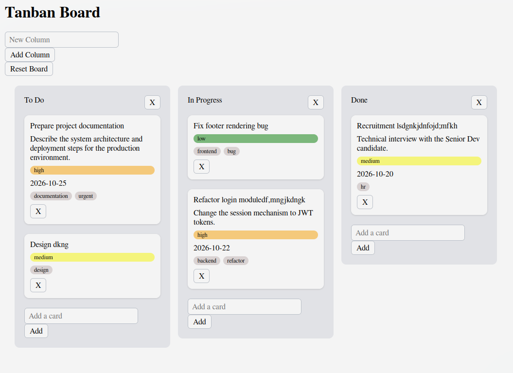
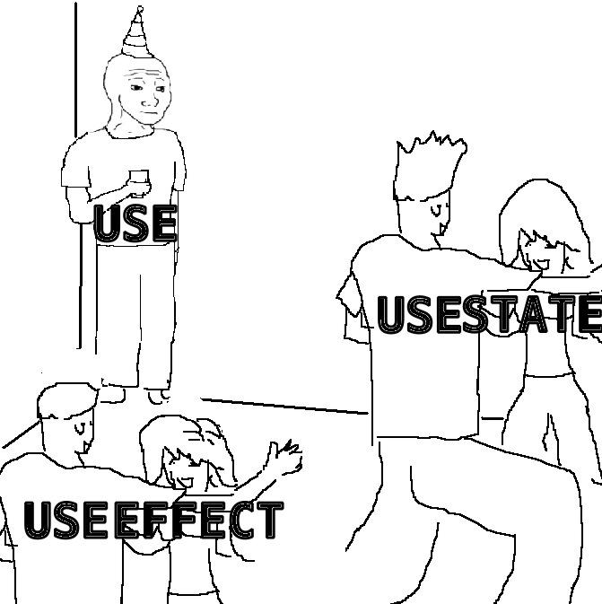

# Tanban board

Its a kanban board clone build with react and Tsx, where everything stores in your browser.

## Screanshot 



## Demo

https://tanban-board-8695.vercel.app/

## Features

- Add and delete a card or column 
- Rename title
- Drag and drops on cards
- Local storage save cards
- reset button
- starting seed

## Tech
React, TypeScript, Vite, @dnd-kit, plain CSS, built in WebStorm

## How to start 
```bash
git clone https://github.com/Tretaq/tanban-board
cd tanban-board
npm install
npm run dev
```

## To Do in future 
- edit all cards 
- drag columns 
- make better css than this shit <33 

## Project meme 

